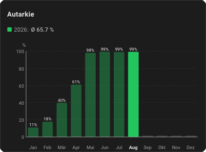
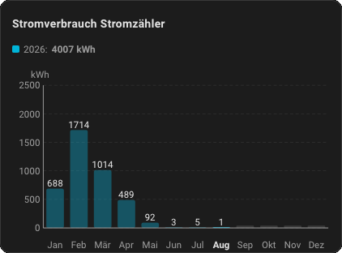
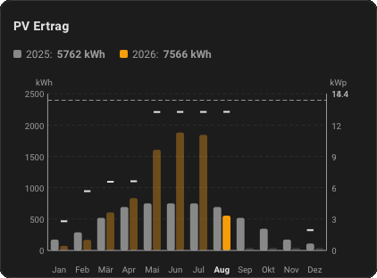
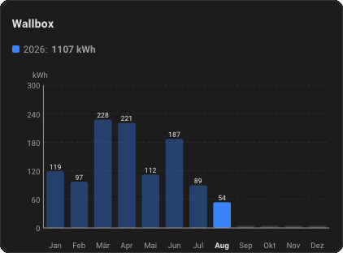
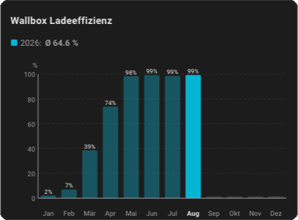
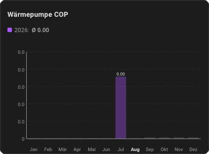
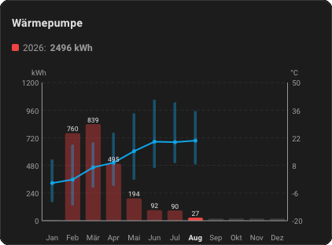
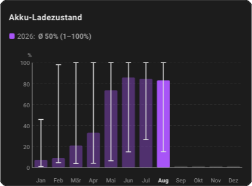
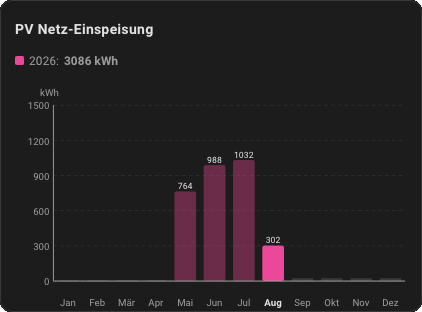
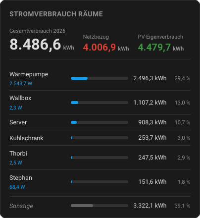

# Energy-Charts-by-Lutarym

[English](README.md) · **Deutsch** · [Français](README.fr.md) · [日本語](README.ja.md)

Version 2.7.0 · [Changelog](CHANGELOG.md)

Lovelace Custom Card für Home Assistant. Eine einzige Karte, deren Verhalten
über `card_type` in einem grafischen Konfigurationsformular gewählt wird. Die
meisten Typen zeichnen monatliche Balkendiagramme (aktuelles Jahr gegen bis zu
3 Vorjahre), einige zeigen ein berechnetes Verhältnis (Effizienz,
Eigenverbrauch, COP), und drei stellen stattdessen eine Übersicht in Zahlen
dar (Stromübersicht und Einspeiseübersicht, beide mit Monatsbalken gegen das
Vorjahr, sowie Raum-Energie). Karte und Editor sprechen
vier Sprachen: Englisch, Deutsch, Französisch und Japanisch. Sie folgen
automatisch `hass.language`, jede andere Spracheinstellung fällt auf Englisch
zurück.

## Kartentypen

Es gibt 14 `card_type`-Vorlagen. Jeder Screenshot unten zeigt die Vorlage in
ihrer Standardgestaltung; Farbe, Titel und Entity lassen sich im Editor
überschreiben.

### autarkie: Autarkie



Monatsdurchschnitt eines Autarkiegrad-Sensors in Prozent. Y-Achse fest
von 0 bis 100 %. Der Jahreswert ist der Durchschnitt, nicht die Summe, und zwar
zeitgewichtet: jeder Monat zählt mit der Zeit, die sein Mittelwert abdeckt,
ein gerade begonnener Monat also nicht so viel wie ein voller.
Standard-Entity: `sensor.autarkie`.

### energy: Stromverbrauch



Monatsverbrauch in kWh (Monatssumme). Automatisch skalierte Y-Achse.
Standard-Entity: `sensor.stromverbrauch`.

### pv: PV Ertrag



Monatlicher PV-Ertrag in kWh (Monatssumme). Zwei optionale Überlagerungen:

- `kwp`: installierte Leistung. Zeichnet eine gestrichelte Referenzlinie gegen
  eine eigene kW-Skala auf der rechten Seite.
- `power_entity`: ein Momentanleistungs-Sensor (kW/W, `state_class:
  measurement`, z. B. die AC-Leistung des Wechselrichters). Zeigt die
  Monatsspitze als kurzen Strich auf jedem Balken, auf derselben rechten
  kW-Achse. Das muss eine **eigene** Entity sein, getrennt vom Ertragssensor:
  der Ertragssensor ist ein kumulativer kWh-Zähler, bei dem nur eine
  Monatssumme sinnvoll ist, während nur ein Momentanleistungs-Sensor ein
  sinnvolles monatliches Maximum liefert.

Standard-Entity: `sensor.pv_ertrag`.

### wallbox: Wallbox



Monatliche Ladeenergie der Wallbox in kWh (Monatssumme). Optionale
Überlagerung:

- `distance_entity`: ein Kilometerstand- oder Fahrtensensor. Zeichnet eine
  Linie der gefahrenen Kilometer auf einer eigenen km-Skala rechts (eine
  Monatssumme wie die Ladeenergie selbst, da die gefahrene Strecke keinen
  sinnvollen Bereich innerhalb des Monats hat).

Standard-Entity: `sensor.wallbox`.

### wallbox_eff: Wallbox Ladeeffizienz



Anteil der Wallbox-Ladung, der ohne Netzbezug stattfand. Festes
Balkendiagramm von 0 bis 100 % je Monat. Benötigt zwei Entities:

- `entity`: gesamte Ladeenergie der Wallbox (kWh).
- `grid_entity`: Netzbezug, angegeben als **Leistung** (W, kW oder jede
  andere Leistungseinheit, die Home Assistant kennt) oder **Energie** (kWh).
  Leistung wird aus den aufgezeichneten Stundenmittelwerten zu Bezugs-kWh
  integriert (nur Bezug, keine Einspeisung).

Gerechnet wird Stunde für Stunde: der Netzbezug einer Stunde deckt zuerst
die Ladung, der netzfreie Teil dieser Stunde ist also
max(0, geladen − Netzbezug). Monatswert = Σ netzfreie kWh ÷ Σ geladene kWh
× 100. Kein Netzbezug während des Ladens bedeutet 100 %. Stunden ohne
Netzwert fallen heraus, statt als netzfrei zu zählen.

Der Jahreswert in der Summenzeile ist energiegewichtet, also
Σ netzfreie kWh ÷ Σ geladene kWh, nicht der Durchschnitt der Monatsquoten.

### eigenverbrauch: Eigenverbrauchsquote

Anteil der PV-Erzeugung, der im Haus verbraucht statt eingespeist wurde.
Festes Balkendiagramm von 0 bis 100 % je Monat. Benötigt zwei Entities:

- `entity`: PV-Ertrag (kWh).
- `feedin_entity`: Netzeinspeisung (kWh).

Monatswert = (PV − Einspeisung) ÷ PV × 100. Beide Werte sind direkt gemessen,
das einfache Monatsverhältnis ist daher exakt. Der Jahreswert ist wie oben
energiegewichtet.

### cop: Wärmepumpe COP



Erzeugte Wärme je eingesetzter Stromeinheit. Automatisch skalierte Achse; der
Wert ist eine Zahl (typisch etwa 2 bis 5), kein Prozentwert, mit 2 Nachkommastellen.
Es gibt zwei Wege dorthin, gewählt mit `cop_source`.

**Berechnet** (`cop_source: calculated`, Standard):

- `entity`: verbrauchte elektrische Energie (kWh).
- `heat_entity`: erzeugte thermische Energie (kWh, z. B. aus HeishaMon).

Monatswert = Wärme ÷ Strom. Braucht einen echten Wärmemengensensor, um
aussagekräftig zu sein. Der Jahreswert ist die Jahresarbeitszahl
Σ Wärme ÷ Σ Strom, nicht der Durchschnitt der zwölf Monats-COPs.

**Aus einer COP-Entität der Wärmepumpe** (`cop_source: entity`):

- `cop_entity`: ein Sensor, der den COP selbst liefert. **Pflicht.**
- `entity`: Stromzähler der Wärmepumpe (kWh). Optional, aber empfohlen.

Ein COP-Sensor ist ein Augenblickswert, und sein einfacher Zeitdurchschnitt
ist nicht die Jahresarbeitszahl, weil auch der Stillstand mitzählt. Ist der
Stromzähler gesetzt, zählt jede Stunde mit ihrem Stromverbrauch:
Σ (COP × Strom) ÷ Σ Strom, je Monat und je Jahr. Ist der COP innerhalb einer
Stunde gleich, ist das genau Σ Wärme ÷ Σ Strom, also derselbe Wert wie im
Rechenmodus. Stunden ohne COP-Wert fallen heraus. Ohne Stromzähler zeigt
die Karte den Zeitdurchschnitt des COP-Sensors, im Jahr zeitgewichtet.
Zeigt der Sensor im Stillstand 0, ist der Rechenmodus genauer: innerhalb
einer Stunde sieht die Karte nur den Mittelwert.

### wp: Wärmepumpe



Monatlicher Stromverbrauch der Wärmepumpe in kWh (Monatssumme). Optionale
Überlagerung:

- `temperature_entity`: ein Außentemperatursensor. Zeichnet eine
  Temperaturlinie auf einer eigenen °C-Skala rechts (diese Achse hat ein
  echtes Minimum **und** Maximum, da Wintermonate ins Negative gehen).
  Auflösung über `temp_mode`:
  - `daily` (Standard): ein Punkt je Kalendertag, wie im Verlaufsdiagramm von
    Home Assistant. Vereinfacht sich unterhalb von etwa 500 px Kartenbreite
    automatisch zu einem monatlichen Min/Max-Band, unterhalb von etwa 280 px
    zu einer einfachen Monatsmittellinie, jeweils aus denselben Tagesdaten
    ohne zusätzliche Abfrage.
  - `minmax`: immer ein monatliches Min/Max-Band plus Mittellinie.
  - `mean`: immer eine einfache Monatsmittellinie.

Standard-Entity: `sensor.waermepumpe`.

### klima: Klimaanlage

Monatlicher Stromverbrauch der Klimaanlage in kWh (Monatssumme). Unterstützt
dieselbe optionale `temperature_entity` / `temp_mode`-Überlagerung wie `wp`
(mehr Klimabetrieb fällt meist in die heißeren Monate).
Standard-Entity: `sensor.klimaanlage`.

### akku: Akku-Ladezustand



Monatlicher Ladezustand des Akkus. Y-Achse fest von 0 bis 100 %. Der Balken beginnt
immer bei 0 (Höhe = Monatsmittel, wie bei allen anderen Vorlagen).
`stat_mode` wählt die Darstellung:

- `mean` (Standard): einfacher Monatsdurchschnitt.
- `minmax`: das monatliche Min/Max wird als Whisker überlagert (eine
  senkrechte Linie mit Endkappen, auf derselben Skala wie der Balken). In
  diesem Modus gibt es keine eigene Zahlenbeschriftung; die genauen
  Ø/Min/Max-Werte stehen in der Summenzeile über dem Diagramm.

Standard-Entity: `sensor.akku_ladezustand`.

### einspeisung: PV Netz-Einspeisung



Monatliche Netzeinspeisung in kWh (Monatssumme). Diese Vorlage hat **keine
Standard-Entity**: ein geratener Sensorname würde in keiner echten Anlage
passen, deshalb zeigt die Karte einen kurzen Hinweis "Entity auswählen", bis
eine konfiguriert ist.

### overview: Stromübersicht

Eine Übersicht über Stromkosten und Verbrauch des laufenden Jahres:

- oben die Stromkosten bisher und daneben, um wie viel Prozent sie vom
  gleichen Zeitraum des Vorjahres abweichen (rot teurer, grün günstiger),
- darunter die Kosten je Monat als Balken, das Vorjahr grau daneben und der
  Abschlag als gestrichelte Linie,
- mit Abschlag der Abschlag-Block: Abschlag im Monat und im Jahr, bisher
  bezahlt, bisher aufgelaufen und daraus Nachzahlung oder Guthaben bisher,
- unten der Verbrauch in kWh mit Prozent zum Vorjahreszeitraum und der
  Verbrauch des ganzen Vorjahres.

Fährt man über einen Monat oder tippt ihn an, zeigt ein Hinweis die Kosten
dieses Monats in beiden Jahren. Konfiguration:

- `energy_entity`: Energiesensor (kWh). **Pflicht.**
- `price_per_kwh`: Preis pro kWh in EUR (z. B. `0.32` für 32 ct/kWh).
  **Pflicht.**
- `base_fee_yearly` oder `base_fee_monthly`: Grundgebühr (eines von beiden).
- `base_fee_mode`: `accrued` (Standard, anteilig zum abgelaufenen Teil des
  Jahres) oder `full` (der volle Betrag). Gilt für die Kosten oben;
  Monatsbalken, Euro-Vergleich und Abschlag-Vergleich rechnen die
  Grundgebühr immer anteilig.
- `monthly_payment`: Abschlag, den du monatlich an deinen Stromanbieter
  zahlst. Ohne Angabe entfallen Abschlag-Linie und Abschlag-Block.
- `billing_start_month`: Monat, in dem dein Abrechnungsjahr beginnt, `1` bis
  `12` (Standard `1`, Januar). Gilt nur für den Abschlag-Vergleich.
- `previous_price_per_kwh`: Preis des Vorjahres pro kWh für den
  Euro-Vergleich. Leer heißt: aktueller Preis.
- `previous_base_fee_yearly` oder `previous_base_fee_monthly`: Grundgebühr
  des Vorjahres für den Euro-Vergleich. Leer heißt: aktuelle Grundgebühr.
- `currency`: Standard `EUR`.
- `previous_year_kwh`: optionale manuelle Vorgabe für den Vorjahreswert.
  Normalerweise automatisch aus der Statistik berechnet (1.1. bis 31.12. des
  Vorjahres); wird er gesetzt, entfallen die Prozentvergleiche.

**Abschlag-Vergleich.** Gezählt wird je angefangenem Monat ab Beginn des
Abrechnungsjahres: bei Beginn im Januar sind es am 25. November 11 Abschläge.
Aufgelaufen ist der Verbrauch seit Beginn des Abrechnungsjahres zum aktuellen
Preis plus die anteilige Grundgebühr. Ist mehr aufgelaufen als bezahlt, steht
dort die Nachzahlung bisher, sonst das Guthaben bisher. Beginnt das
Abrechnungsjahr nicht im Januar, nennt die Karte den Beginn.

**Vergleich mit dem Vorjahr.** Beide Prozentangaben laufen gegen den
**gleichen Zeitraum** des Vorjahres, nicht gegen das volle Vorjahr, und über
volle Tage: 1.1. bis gestern gegen 1.1. bis zum selben Datum vor einem Jahr.
Der heutige Tag hat gerade erst begonnen und stünde sonst gegen einen vollen
Tag. Beginnt der Zähler erst im Lauf des Vorjahres, starten beide Zeiträume
an diesem Kalendertag, damit ein neuer Zähler keinen Mehrverbrauch zeigt,
den es nicht gibt. Ein Vergleich mit dem vollen Vorjahr wäre vom Kalender
bestimmt: im September stünde dort immer ein großes Minus, egal wie sich der
Verbrauch entwickelt hat. In Euro rechnet die Karte das Vorjahr mit Preis und
Grundgebühr des Vorjahres, soweit angegeben, sonst mit den aktuellen Werten;
dann liegt die Euro-Prozentzahl nahe an der kWh-Prozentzahl.

### overview_feedin: Einspeiseübersicht

Dieselbe Übersicht für die Einspeiserichtung: gleiche Abfrage, gleiche
Rechnung und gleicher Vorjahresvergleich wie bei `overview`, angewandt auf
den Einspeisezähler. Aus Kosten werden Einnahmen, die Vergütung mal die im
laufenden Jahr eingespeisten kWh, mit Prozent zum Vorjahreszeitraum. Die
Balken zeigen die Vergütung je Monat, die gestrichelte Linie die monatliche
Einzahlung: die bisherige Vergütung geteilt durch 12. Mehr Einspeisung ist
hier das bessere Ergebnis, ein Plus erscheint deshalb grün und ein Minus
rot. Grundgebühr und Abschlag gibt es bei der Einspeisevergütung nicht, die
Felder dafür entfallen. Konfiguration:

- `energy_entity`: Einspeisezähler (kWh). **Pflicht.**
- `price_per_kwh`: Vergütung pro kWh in EUR (z. B. `0.082` für 8,2 ct/kWh).
  **Pflicht.**
- `previous_price_per_kwh`: Vergütung des Vorjahres pro kWh für den
  Euro-Vergleich. Leer heißt: aktuelle Vergütung.
- `currency`: Standard `EUR`.
- `previous_year_kwh`: optionale manuelle Vorgabe für die Einspeisung des
  Vorjahres; wird sie gesetzt, entfallen die Prozentvergleiche.

### rooms: Stromverbrauch Räume



Kein Balkendiagramm. Jahres-kWh je Raum mit dem prozentualen Anteil am
Hausverbrauch. Konfiguration:

- `total_entity`: Gesamt- oder Netzbezugszähler (optional, z. B. OBIS 1.8.0).
  Leer lassen für eine reine Raumansicht (Anteil an der Raumsumme, ohne Zeile
  "Sonstige").
- `pv_entity`: PV-Ertrag (optional, kWh).
- `feedin_entity`: Netzeinspeisung (optional, kWh). Sind `pv_entity` und
  `feedin_entity` beide gesetzt, gilt: echter Verbrauch = Netzbezug +
  (PV-Ertrag − Einspeisung). Die Zeile "Sonstige" und die Anteile geben dann
  den tatsächlichen Verbrauch einschließlich PV-Eigenverbrauch wieder.
- `rooms`: bis zu 10 Räume, jeder mit frei wählbarem `name`, eigener Energie-
  `entity` und optionaler Live-`power_entity`.
- `rooms_columns`: `1` (Standard), `2` oder `3`. Ordnet die Räume
  nebeneinander statt untereinander an, was die Karte bei vielen Räumen
  kompakt hält. Ist die Karte schmaler als etwa 220px je Spalte, fällt sie
  von selbst auf weniger Spalten zurück.
- Unter der Liste steht ein Gesamtbalken: alle Räume nebeneinander in einem
  Streifen, jeder Raum in eigener Farbe, darunter die Zuordnung von Farbe zu
  Raum. Er zeigt auf einen Blick, wie sich der Gesamtverbrauch aufteilt.

#### Automatische Erkennung

Statt die Räume von Hand einzutragen, kann die Karte sie selbst finden. Im
Editor **Räume automatisch erkennen** einschalten oder `rooms_auto: true`
setzen.

Ein Zähler kommt in Frage, wenn er die Geräteklasse `energy` und eine
State-Class `total` oder `total_increasing` hat. Nur für diese gibt es die
`change`-Statistik, mit der die Karte rechnet. Die passenden Zähler werden
dann **nach dem Bereich gruppiert**, dem sie in Home Assistant zugeordnet
sind, direkt oder über ihr Gerät. Je Bereich entsteht eine Zeile: der Name
ist der Bereichsname, die kWh sind die Summe der Zähler dieses Bereichs, und
der Live-Wattwert ist die Summe ihrer Leistungssensoren. Ein Leistungssensor
gehört zu einem Zähler, wenn beide Entity-IDs nach dem Abschneiden des
letzten Wortes denselben Stamm haben, so findet
`sensor.wallbox_strom_energie` seinen Partner
`sensor.wallbox_strom_leistung`.

Zähler ohne Bereich bleiben außen vor. Ihr Verbrauch geht nicht verloren:
mit gesetzter `total_entity` erscheint er in der Zeile "Sonstige", die die
Differenz zwischen Hausverbrauch und den gelisteten Räumen ist.

Die Bereichszuordnung wird einmal je Karte über
`config/area_registry/list`, `config/device_registry/list` und
`config/entity_registry/list` gelesen. Diese drei sind nicht adminpflichtig,
anders als die Schreibbefehle derselben Registries. Sind sie nicht lesbar,
fällt die Karte auf eine Zeile je Zähler zurück und sagt das im Editor.

Immer ausgeschlossen, ohne Konfiguration:

- die oben gesetzten `total_entity`, `pv_entity` und `feedin_entity`. Als
  Raum gezählt würden sie die Prozentanteile unbrauchbar machen
- Zeitraum-Varianten desselben Zählers, erkannt an einem Wort wie `heute`,
  `taeglich`, `monat`, `jahr` oder `today` in der Entity-ID.
  Utility-Meter-Helfer tragen dieselbe Geräteklasse und würden denselben
  Verbrauch ein zweites Mal auflisten
- Zähler für Einspeisung, Erzeugung oder eine einzelne Phase, erkannt an
  einem Wort wie `returned`, `export`, `einspeisung`, `production`,
  `erzeugung`, `ertrag`, `pv`, `solar`, `phase`, `l1`, `l2` oder `l3` in Entity-ID
  oder Name. Neben dem eigentlichen Zähler im selben Bereich würden sie
  dessen Verbrauch doppelt zählen oder Erzeugung als Verbrauch buchen
- alles, was kein Zähler ist, etwa ein reiner Momentanwert

Zwei optionale Filter:

- `rooms_auto_include`: nur Entities, deren ID oder Name diesen Text enthält.
- `rooms_auto_exclude`: kommagetrennte Entity-IDs oder Textteile, die
  wegfallen sollen.

Der Editor listet jeden Treffer mit Entity-ID schon beim Tippen auf, du
siehst also vor dem Speichern, was ein Filter bewirkt. Bei aktiver Automatik
wird die manuelle `rooms`-Liste ignoriert; beim Ausschalten ist sie
unverändert wieder da.

```yaml
type: custom:energy-charts-by-lutarym
card_type: rooms
rooms_auto: true
rooms_auto_exclude: sensor.kuehlschrank_energie
total_entity: sensor.grid_import
pv_entity: sensor.pv_ertrag
feedin_entity: sensor.pv_feedin
```

## Installation über HACS

1. HACS → **⋮** → Benutzerdefinierte Repositories
2. URL dieses Repositorys eintragen, Kategorie **Dashboard**
3. "Energy-Charts-by-Lutarym" installieren
4. Home Assistant neu laden (bei Bedarf den Browser-Cache leeren)

## Manuelle Installation

`dist/energy-charts-by-lutarym.js` nach `config/www/` kopieren:

```yaml
resources:
  - url: /local/energy-charts-by-lutarym.js
    type: module
```

## Verwendung

Hinzufügen über **Dashboard bearbeiten → Karte hinzufügen →
"Energy-Charts-by-Lutarym"**. Das öffnet direkt das grafische
Konfigurationsformular, der empfohlene Weg für alle Optionen unten. Unten
im Formular steht die installierte Version.

Monate, Tage und Jahre richten sich nach der Zeitzone, die in Home Assistant
eingestellt ist, so wie Home Assistant auch seine Statistik zusammenfasst,
und nicht nach der Zeitzone des Browsers. Zahlen folgen dem Zahlenformat aus
deinem Home-Assistant-Profil.

```yaml
type: custom:energy-charts-by-lutarym
card_type: pv            # autarkie | energy | pv | wallbox | wallbox_eff | eigenverbrauch | cop | wp | klima | akku | einspeisung | overview | overview_feedin | rooms
years_back: 2             # optional: 0 | 1 | 2 | 3 zusätzliche Vorjahre (Standard: 1); nur Balken-Vorlagen
show_values: true         # optional: Zahl über jedem Balken (nicht die Achsenskala), Standard: true; Balken-Vorlagen
show_legend: false        # optional: kleine Jahres-Marker im Diagramm, Standard: false
y_max: null               # optional: fester oberer Wert der Y-Achse (leer lassen für automatisch)
y_headroom: 20            # optional: zusätzlicher Platz in % über dem höchsten Balken im Automatikmodus (Standard: 20)

# --- nur akku ---
stat_mode: mean           # mean | minmax (Balken bleibt bei 0, Min/Max als Whisker, keine eigene Achse)

# --- nur pv ---
kwp: 14.4                 # installierte Leistung: gestrichelte Referenzlinie gegen eine kW-Skala rechts
power_entity: sensor.xyz  # Momentanleistungs-Sensor: Monatsspitze als Strich je Balken

# --- nur wp / klima ---
temperature_entity: sensor.aussentemperatur # Außentemperatur: Temperaturlinie
temp_mode: daily          # daily | minmax | mean (Standard: daily)
color_temp: "#0ea5e9"    # Farbe der Temperaturlinie (Standard: Himmelblau)

# --- nur wallbox ---
distance_entity: sensor.auto_odometer # Kilometerstand-/Fahrtensensor: Linie der gefahrenen km
color_distance: "#84cc16" # Farbe der Kilometerlinie (Standard: Limettengrün)

# --- nur wallbox_eff ---
grid_entity: sensor.grid_power   # Pflicht: Netzbezug (Leistung W/kW oder Energie kWh)

# --- nur eigenverbrauch ---
feedin_entity: sensor.pv_feedin  # Pflicht: Netzeinspeisung (kWh)

# --- nur cop ---
heat_entity: sensor.heat_produced # Pflicht: erzeugte thermische Energie (kWh)
# oder den COP direkt von der Wärmepumpe nehmen:
# cop_source: entity              # calculated (Standard) | entity
# cop_entity: sensor.wp_cop       # Pflicht bei cop_source: entity

# --- nur overview ---
energy_entity: sensor.stromverbrauch # Pflicht
price_per_kwh: 0.32       # Pflicht (EUR pro kWh)
base_fee_yearly: 120      # oder base_fee_monthly: 10
base_fee_mode: accrued    # accrued (anteilig) | full
monthly_payment: 175      # optional: Abschlag pro Monat
billing_start_month: 3    # optional: Beginn des Abrechnungsjahres (1 bis 12)
previous_price_per_kwh: 0.30   # optional: Preis des Vorjahres
previous_base_fee_monthly: 10  # optional: Grundgebühr des Vorjahres
currency: EUR
previous_year_kwh: 4200   # optionale manuelle Vorgabe

# --- nur overview_feedin ---
energy_entity: sensor.einspeisung # Pflicht: Einspeisezähler (kWh)
price_per_kwh: 0.082      # Pflicht (Vergütung, EUR pro kWh)
previous_price_per_kwh: 0.08   # optional: Vergütung des Vorjahres
currency: EUR
previous_year_kwh: 3900   # optionale manuelle Vorgabe

# --- nur rooms ---
total_entity: sensor.grid_import  # optional
rooms_columns: 2                  # optional: 1 | 2 | 3
pv_entity: sensor.pv_ertrag       # optional
# feedin_entity: sensor.pv_feedin # optional (siehe Abschnitt rooms)
rooms:
  - name: Wohnzimmer
    entity: sensor.room_wohnzimmer
    power_entity: sensor.room_wohnzimmer_power  # optional
  - name: Büro
    entity: sensor.room_buero

# --- Darstellung (alle Typen) ---
color: "#f59e0b"         # Hauptfarbe für das aktuelle Jahr
color_prev: "#888888"    # Farbe für das unmittelbare Vorjahr
color_text: "#1c1c1c"    # Farbe für Text und Werte (Standard: folgt dem Theme)
color_dim: "#f59e0b55"   # gedämpfte Farbe (vergangene Monate, aktuelles Jahr)
appearance: auto          # auto | light | dark
title: "Mein Titel"       # optional: überschreibt den Titel der Vorlage
title_font_size: 14       # optional, Standard 14px
label_font_size: 10       # optional, Standard: automatisch
```

Beim Überfahren eines Balkens mit der Maus erscheint ein kleiner Tooltip mit
Monat, Jahr und dem genauen Wert (Ø mit Min/Max-Bereich im akku-Min/Max-Modus;
die Spitzenleistungs-Striche der pv-Vorlage zeigen ebenfalls ihren Wert).

### Übersicht der Vorlagen

| card_type | Standard-Entity | Titel | Farbe | Zusätzlich nötige Entity |
|---|---|---|---|---|
| autarkie | sensor.autarkie | Autarkie | `#22c55e` | *(keine)* |
| energy | sensor.stromverbrauch | Stromverbrauch | `#facc15` | *(keine)* |
| pv | sensor.pv_ertrag | PV Ertrag | `#f59e0b` | *(keine)* |
| wallbox | sensor.wallbox | Wallbox | `#3b82f6` | *(keine)* |
| wallbox_eff | *(keine)* | Wallbox Ladeeffizienz | `#6366f1` | `grid_entity` |
| eigenverbrauch | *(keine)* | Eigenverbrauchsquote | `#84cc16` | `feedin_entity` |
| cop | *(keine)* | Wärmepumpe COP | `#d946ef` | `heat_entity` oder `cop_entity` |
| wp | sensor.waermepumpe | Wärmepumpe | `#ef4444` | *(keine)* |
| klima | sensor.klimaanlage | Klimaanlage | `#06b6d4` | *(keine)* |
| akku | sensor.akku_ladezustand | Akku-Ladezustand | `#8b5cf6` | *(keine)* |
| einspeisung | *(keine)* | PV Netz-Einspeisung | `#ec4899` | *(keine)* |
| overview | *(keine)* | Stromübersicht | `#0ea5e9` | `energy_entity`, `price_per_kwh` |
| overview_feedin | *(keine)* | Einspeiseübersicht | `#ec4899` | `energy_entity`, `price_per_kwh` |
| rooms | *(keine)* | Stromverbrauch Räume | `#10b981` | Liste `rooms` |

Die Standard-Entities sind Platzhalter; trage im Editor deine tatsächliche
Entity-ID ein. Vorlagen mit *(keine)* haben überhaupt keinen Standard und
zeigen einen kurzen Hinweis "Entity auswählen", bis eine konfiguriert ist.

## Laden und Zwischenspeicher

Die Karte merkt sich die zuletzt geladenen Werte, im Speicher und im
localStorage des Browsers. Wird eine Karte neu aufgebaut, etwa beim
Bearbeiten des Dashboards oder in der Editor-Vorschau, zeigt sie die Werte
sofort und fragt nicht neu. Nach dem Neuladen der Seite erscheinen die
letzten Werte gleich und werden im Hintergrund frisch geholt. Gleiche
Statistikabfragen mehrerer Karten laufen nur einmal, und die Monatswerte
aller Jahre kommen in einer Abfrage. Gespeichert werden nur fertig
gerechnete Werte, höchstens sieben Tage lang. Ein Doppelklick auf eine
Balkenkarte lädt sofort neu.

## Lizenz

Private Nutzung.
